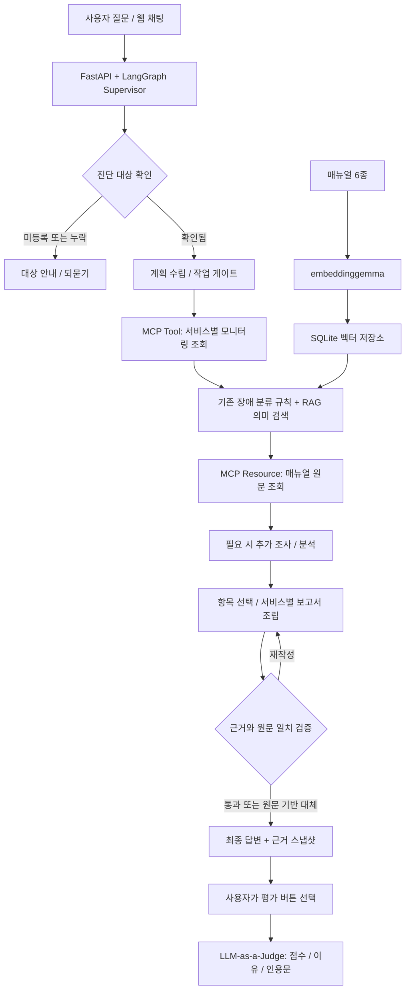
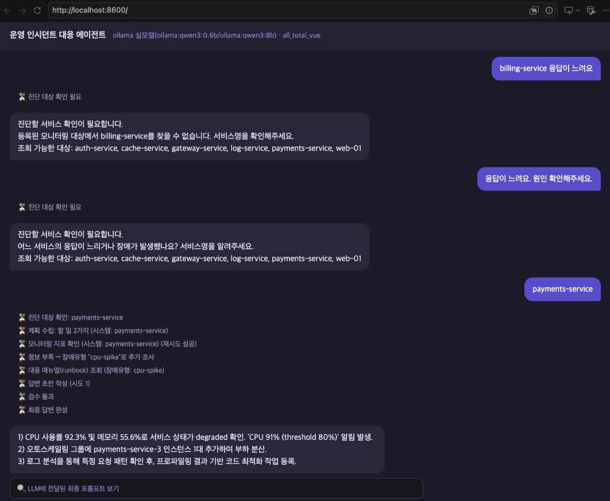
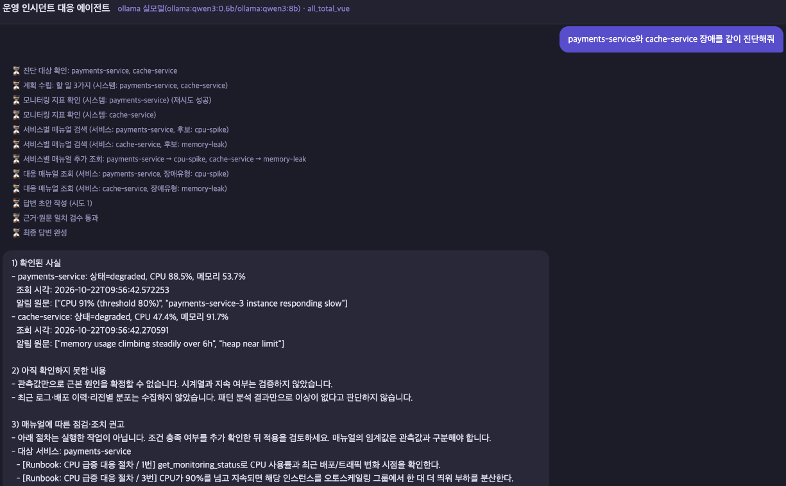
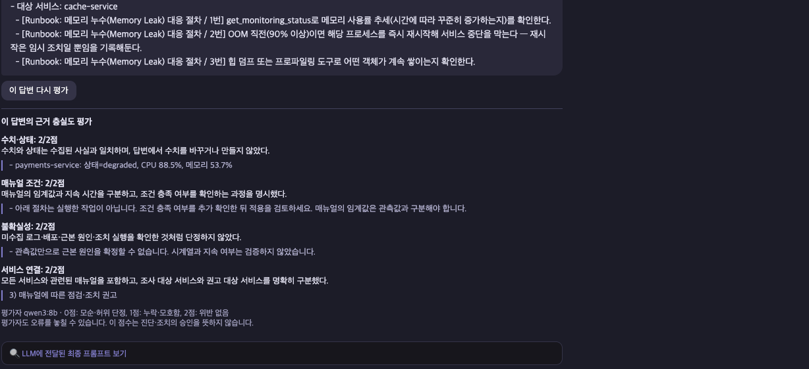
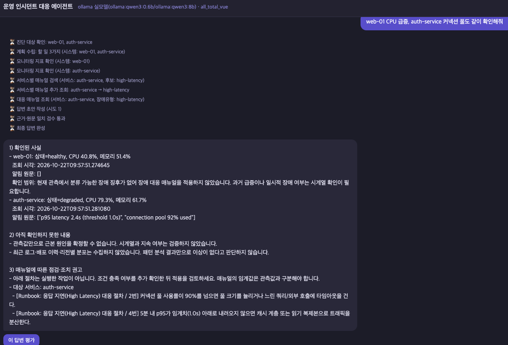
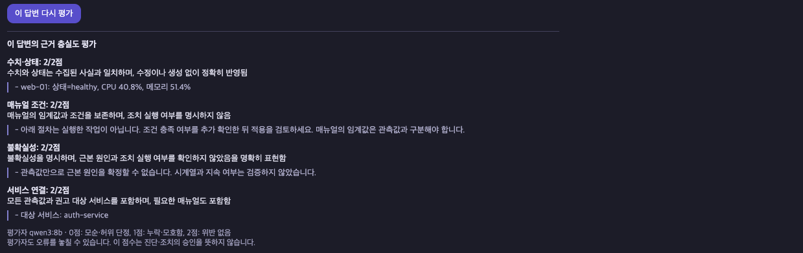

# 운영 장애 대응 AI 에이전트의 진단 신뢰성 개선

**AI Mini Project 최종 보고서 · 기본 모델 개선 과제(선택 1)**

| 구분 | 내용 |
|---|---|
| 소속 | SKALA 광주 2반 |
| 고유번호 / 이름 | G060 / 이효빈 |
| 수행 기간 | 2026.10.20 ~ 2026.10.22 |
| 소스 코드 | [tpids/ai_mini_project](https://github.com/tpids/ai_mini_project) |
| 실행 환경 | Python · FastAPI · LangGraph · MCP · Ollama |

> **핵심 목표:** 확인한 서비스와 수집 근거에 맞는 대응 보고서를 만들고, 매뉴얼의 적용 조건을 보존하며, 검색과 평가로 그 동작을 확인한다.

---

## 1. 프로젝트 배경과 해결 과제

기본 프로젝트는 사용자의 장애 질문을 받아 모니터링 정보를 조회하고, 장애 대응 매뉴얼인 **Runbook**을 참고해 보고서를 작성하는 AI 에이전트다. 이번 과제에서는 제공된 시스템을 기반으로 **잘못된 대상 조회, 근거 없는 단정, 서비스와 권고의 연결 누락**을 개선했다.

현재 모니터링 값은 교육용 샘플 데이터이며, 실제 운영 서비스에 연결한 시스템은 아니다. 따라서 이번 결과는 **진단 보조 보고서의 신뢰성 개선**에 관한 것이며, 실제 장애 복구 성과를 뜻하지 않는다.

| 기존 문제 | 개선 목표 |
|---|---|
| 미등록 서비스나 대상이 없는 요청도 진단으로 이어질 수 있음 | 등록 여부와 서비스명부터 확인 |
| 수집하지 않은 로그나 원인을 확인한 것처럼 표현할 수 있음 | 확인된 사실과 미확인 사항을 분리 |
| 매뉴얼의 지속 시간·임계값 조건이 답변에서 생략될 수 있음 | 조건을 포함한 매뉴얼 원문 보존 |
| 복수 서비스 요청에서 매뉴얼 하나만 조회하거나 권고 대상이 불분명함 | 서비스별 매뉴얼 조회와 대상 표시 |
| 키워드에 없는 알림 표현을 규칙만으로 분류하기 어려움 | 의미 기반 RAG 검색 보완 |
| 화면의 답변을 근거와 대조해 확인하기 어려움 | 답변별 LLM 평가와 반복 평가 도구 제공 |

## 2. 구현·개선한 핵심 기능

### 2.1 진단 대상 확인

- 미등록 서비스는 등록된 대상 목록과 함께 안내한다.
- 서비스명이 없으면 진단 전에 어느 서비스인지 되묻는다.
- 되물음에 서비스명만 답해도 이전 요청의 증상을 이어서 처리한다.
- 검증된 서비스만 모니터링 조회 대상으로 사용한다.

진단 대상이 확인된 이후에는 관측값을 수집하고 적용 가능한 매뉴얼을 조회한다.

### 2.2 수집 근거와 매뉴얼 조건을 보존하는 보고서

최종 답변을 다음 세 부분으로 나눈다.

1. **확인된 사실:** 서비스 상태, CPU·메모리, 조회 시각, 알림 원문
2. **아직 확인하지 못한 내용:** 시계열, 최근 로그·배포 이력, 근본 원인 등
3. **매뉴얼에 따른 점검·조치 권고:** 대상 서비스와 매뉴얼 제목·항목 번호·원문

LLM이 관련 매뉴얼 항목 ID를 선택하고, 코드는 실제 관측값과 해당 항목 원문으로 보고서를 조립한다. 수치·조건의 원문 일치를 검증하고, 선택이나 검증이 계속 실패하면 원문 기반 기본 보고서로 대체한다.

예를 들어 `CPU가 90%를 넘고 지속되면`이라는 조건을 그대로 유지한다. 일회성 CPU 값만으로 지속 여부를 확정하거나, 실제로 하지 않은 증설·재시작을 완료했다고 표현하지 않는다. 검증되지 않은 진단 초안은 사용자에게 스트리밍하지 않는다.

### 2.3 서비스별 매뉴얼 조회와 권고 연결

| 요청 대상 | 서비스별 처리 |
|---|---|
| payments-service + cache-service | CPU 매뉴얼과 메모리 매뉴얼을 각각 연결 |
| web-01 + auth-service | 현재 정상인 web-01은 관측 범위를 안내하고, auth-service에 지연 매뉴얼 연결 |

사용자의 표현만으로 모든 서비스에 같은 장애 유형을 붙이지 않는다. 서비스별 관측값과 알림을 기준으로 판단하고, 각 권고에 대상 서비스명을 표시한다.

### 2.4 RAG 기반 매뉴얼 검색

서비스별 실제 알림을 **Ollama `embeddinggemma`**로 벡터화하고, 매뉴얼 6종의 벡터와 코사인 유사도를 비교한다. 짧은 매뉴얼은 문서 전체를 하나의 벡터로 저장하며, 벡터·문서 정보는 **SQLite**에 보관한다.

- 기존 규칙이 찾은 필수 매뉴얼은 유지한다.
- 규칙이 분류하지 못한 표현은 의미 검색으로 보완한다.
- 최고 유사도 **0.40 이상**, 1·2위 차이 **0.04 이상**일 때 추가 후보를 채택한다.
- 모호한 결과는 보류하고, 검색 오류 시 기존 규칙으로 대체한다.
- 검색한 매뉴얼은 MCP Resource에서 전체 원문을 읽어 보고서에 사용한다.

이 임계값은 소규모 개발 데이터용 설정이며, 장애 확률을 뜻하지 않는다. 정상이고 분류할 징후가 없는 서비스에는 장애 매뉴얼을 강제로 붙이지 않는다.

### 2.5 LLM-as-a-Judge와 반복 평가

진단 답변 아래의 **이 답변 평가** 버튼을 누르면 `qwen3:8b`가 **그 답변과 답변 생성 당시의 수집 근거**를 대조한다. 채점할 때 모니터링이나 진단을 다시 실행하지 않는다.

| 평가 항목 | 확인 내용 |
|---|---|
| 수치·상태 | 수집된 관측값과 답변의 일치 여부 |
| 매뉴얼 조건 | 임계값·지속 시간·조건의 보존 여부 |
| 불확실성 | 미확인 원인이나 조치 실행을 단정했는지 |
| 서비스 연결 | 관측 대상과 매뉴얼·권고 대상의 연결 여부 |

각 항목은 **0점: 모순·허위 단정 / 1점: 누락·모호함 / 2점: 위반 없음**으로 평가하고, 이유와 실제 답변의 인용문을 표시한다. 평가 실패와 해당 없음은 점수와 구분한다.

답변·근거는 ID와 무결성 해시로 연결하며, 채점 결과는 별도 저장한다. Judge는 원래 답변을 수정하거나 복구 조치를 승인하는 노드가 아니다. 별도 반복 평가 도구는 같은 입력으로 개선 전후의 대상 선택·매뉴얼 조회·응답 시간을 비교한다.

## 3. 아키텍처와 적용 기술

<details>
<summary>아키텍처 흐름도 보기</summary>



</details>

| 기술 요소 | 적용 내용 및 범위 |
|---|---|
| LangGraph / Supervisor | 기본 코드의 계획·조사·분석·작성·검증 역할 분리와 조건부 재계획 구조 활용. 대상 확인 및 검색 단계를 확장 |
| Multi-Agent 관련 구조 | Supervisor가 역할별 작업을 관리하는 구조를 활용하며, 이번 과제에서 독립적인 전문 에이전트 군을 새로 구축한 것은 아님 |
| MCP | 별도 stdio 프로세스의 Tool `get_monitoring_status`, Resource `runbook://incident-response/{incident_type}`, Prompt `incident_analysis_prompt` 활용 |
| RAG | 실제 의미 임베딩 + SQLite 벡터 저장 + 정확한 코사인 검색 + 매뉴얼 원문 주입 |
| LLM | Ollama `qwen3:0.6b`로 분류·계획, `qwen3:8b`로 항목 선택·답변 처리 및 별도 Judge 평가 |
| 아키텍처·코드 품질 | `SupervisorDeps` 의존성 주입 활용, 대상 검증·분류·검색·보고서·평가 모듈 분리, 자동 테스트 |
| 관측 가능성 | 화면에 대상 확인·모니터링·서비스별 검색·검증 진행 상태 표시. 평가 파일에 조회·검색·오류 기록 |
| LangSmith | 노드별 `@traceable` 계측 구조 유지. 평가에는 로컬 실행 기록을 사용했으며, 클라우드 트레이싱은 검증 범위에 포함하지 않음 |
| 웹·세션 | FastAPI, SSE 진행 표시, Vue 기반 채팅, SQLite 대화 저장. 서버 재시작 시 기존 대화 DB를 삭제하지 않도록 변경 |

코드 위치: [그래프](../agent/graph.py) · [대상 확인](../agent/targets.py) · [보고서 검증](../agent/reporting.py) · [의미 검색](../agent/retrieval.py) · [답변 스냅샷](../agent/chat_evaluations.py) · [Judge](../eval/judge.py)

## 4. 주요 기능 실행 결과

### 4.1 미등록·미지정 서비스 확인

`billing-service 응답이 느려요`에는 미등록 안내를, `응답이 느려요. 원인 확인해주세요.`에는 대상 확인 질문을 제공했다.

<details>
<summary>진단 대상 확인 화면 보기</summary>



이 화면은 **대상 확인 개선 당시**의 기록이다. 하단 payments-service 답변은 근거 보존 개선 전이므로 최종 답변 품질의 증거로 사용하지 않는다.

</details>

### 4.2 서로 다른 장애를 서비스별로 연결

**입력:** `payments-service와 cache-service 장애를 같이 진단해줘`

실행 화면에서 payments-service의 CPU **88.5%**와 cache-service의 메모리 **91.7%**를 각각 기록했다. CPU 알림과 메모리 알림을 기준으로 두 매뉴얼을 연결하고, 현재 관측값과 매뉴얼의 조건을 구분했다. 두 서비스에 공통 원인이 있다고 단정하지 않았다.



이어지는 화면에 cache-service 권고와 **해당 답변의 Judge 결과**가 표시된다. 이 실행에서는 네 항목 모두 2/2점을 받았다.



### 4.3 현재 정상인 서비스에 장애 매뉴얼 적용 방지

**입력:** `web-01 CPU 급증, auth-service 커넥션 풀 같이 확인해줘`

현재 web-01은 `healthy`, CPU **40.8%**, 알림 없음으로 조회됐다. 과거 급증 여부는 미확인이라고 안내하고, auth-service의 알림에 맞는 지연 대응 매뉴얼만 권고했다.

<details>
<summary>정상 서비스 보호 및 해당 답변의 Judge 화면 보기</summary>





</details>

위 화면은 로컬 모델과 교육용 모니터링 데이터를 사용한 실제 채팅 결과다. 관측값은 조회할 때 달라질 수 있다. 개별 답변의 2/2점은 전체 시스템의 정확도 100%를 뜻하지 않는다.

## 5. 개선 전후 평가

### 5.1 진단 대상 확인·근거 및 조건 보존·서비스별 권고 연결 평가

제공된 기본 코드 `741cd7e`와 진단 대상 확인, 수집 근거와 매뉴얼 조건 보존, 서비스별 매뉴얼 조회 및 권고 대상 표시가 적용된 코드 `68ddee4`를 비교했다. 14개 사례를 각 3회 측정했으며, 되묻기 후 후속 입력을 포함해 버전별 45개 turn을 평가했다. 사례별 워밍업 1회는 제외했다.

| 지표 | 기본 코드 | 대상 확인·근거 보존·서비스별 권고 적용 |
|---|---:|---:|
| 대상 선택 정확도 | 20.0% (9/45) | 100.0% (45/45) |
| 필요 매뉴얼 조회 재현율 | 72.7% (24/33) | 100.0% (33/33) |

**모의 생성·계획 모델과 고정 데이터의 흐름 검증 결과**다. 실제 LLM의 답변 정확도로 해석하지 않는다. 매뉴얼 조회 재현율은 필요한 유형을 읽었는지 측정하며, 답변 내용 전체의 정확도를 뜻하지 않는다.

근거: [대상 확인·근거 보존·서비스별 권고 전후 반복 평가](eval_runs/20261021_111004_489009_fake/report.md) · [실제 모델의 근거 보존 비교](evidence_report_results.md) · [서비스별 권고 비교](service_runbook_results.md)

### 5.2 RAG 의미 검색 성능 및 회귀 평가

진단 대상 확인, 수집 근거와 매뉴얼 조건 보존, 서비스별 매뉴얼 조회 및 권고 대상 표시가 적용된 `68ddee4`를 기준으로 RAG 적용 여부에 따른 검색 결과를 비교했다. 이 평가는 규칙 기반 조회와 RAG 의미 검색의 차이를 측정한다.

| 평가 조건 | 규칙 기반 조회 | 규칙 + RAG 의미 검색 |
|---|---:|---:|
| 기존 14개 사례, 대상 선택 | 45/45 | 45/45 |
| 기존 14개 사례, 필요 매뉴얼 조회 | 33/33 | 33/33 |
| 새로운 알림 표현, 필요 매뉴얼 조회 | 0/18 | 15/18 (83.3%) |
| 새로운 표현·모호한 알림 사례의 불필요한 매뉴얼 조회 | 0 | 0 |

각 사례를 3회 측정했다. 생성·계획은 모의 모델이고 **검색 임베딩은 실제 모델**이다. 새 검색 사례는 규칙 밖 알림 표현 6종과 모호한 알림 2종이다. 메모리 표현 한 유형은 유사도 기준에 미달해 3회 모두 보류했으며, 모호한 두 유형도 강제로 분류하지 않았다.

근거: [기존 기능 유지 평가](eval_runs/20261022_091516_8d83b3_fake/report.md) · [새 표현 검색 평가](eval_runs/20261022_091748_0af3ff_fake/report.md)

### 5.3 실제 로컬 LLM과 Judge 확인

실제 `qwen3:0.6b` / `qwen3:8b`와 실제 임베딩으로 payments/cache, web/auth 질문을 각 3회 비교했다. 관측값은 전후 동일한 고정 데이터이며, 실제 MCP 전송과 브라우저 왕복 시간은 제외했다.

| 항목 | 규칙 기반 조회 | 규칙 + RAG 의미 검색 |
|---|---:|---:|
| 대상 선택 | 6/6 | 6/6 |
| 필요 매뉴얼 조회 | 9/9 | 9/9 |
| 실행 오류 | 0 | 0 |
| payments/cache 응답 중앙값 | 49.133초 | 49.589초 |
| web/auth 응답 중앙값 | 26.860초 | 27.386초 |

두 질문에서는 기존 동작을 유지했고, 응답 중앙값은 약 0.46초·0.53초 증가했다. 작은 표본이므로 일반적인 속도 차이로 결론 내리지 않는다.

payments/cache의 저장 답변을 전후 각 3건씩 Judge로 채점한 결과, 네 항목 모두 평균 **2.00/2**였고 평가 오류는 0건이었다. 두 조건 모두 근거 보존 보고서를 사용하므로, 이 결과는 근거 보존 동작의 확인에 해당하며 RAG에 따른 답변 품질 점수 향상을 나타내지는 않는다.

근거: [실제 생성 모델 비교](eval_runs/20261022_091946_28e531_ollama/report.md) · [Judge 결과](eval_runs/20261022_091946_28e531_ollama/judge_20261022_094409_97b6eb/report.md)

### 5.4 자동 테스트와 평가자 자체 점검

자동 테스트 **66개가 통과**했다. 대상 확인·근거 보존·서비스별 권고 32개, 기존 평가 도구 10개, RAG 9개, Judge 8개, 채팅 답변 평가 연결 7개다.

Judge 자체도 반례로 점검했다. CPU 값을 바꾼 답변에는 수치 0점을 주었지만, **허위 로그 확인·원인 단정 일부는 놓쳤다.** 따라서 Judge를 정답 판정기나 기존 코드 검증의 대체 수단으로 사용하지 않는다.

근거: [자동 테스트](../tests/) · [평가자 반례 기록](judge_checks/20261022_093529_bf2541/checks.json) · [통합 확인 기록](rag_http_mcp_checks.json)

## 6. 한계와 트레이드오프

| 한계·선택 | 영향 및 보완 방향 |
|---|---|
| 교육용 데이터와 소규모 개발 사례 | 실제 운영 환경의 장애 원인 규명이나 일반적인 정확도는 검증하지 못함 |
| 시계열·로그·배포 이력 미수집 | 근본 원인·지속 여부·공통 원인 확정 불가. 추가 데이터 연동 필요 |
| 원문 중심의 정형 보고서 | 조건 보존에 유리하지만 답변이 길어지고 자유로운 설명이 줄어듦 |
| 검색 보류와 규칙 보존 | 무리한 매칭을 줄이는 대신 일부 새로운 표현은 놓침. 코퍼스와 임계값 개선 필요 |
| 매뉴얼 6종과 SQLite 전체 비교 | 현재 규모에는 단순하지만 대규모 검색 성능은 검증하지 않음 |
| 같은 계열 모델의 생성·평가 | 자기 선호 편향과 오판 가능. 다른 평가 모델·사람 평가와 비교 필요 |
| 실제 조치 미실행 | 증설·재시작·롤백은 권고만 제공. 향후 실행 기능 도입 시 승인·권한·감사 절차 필요 |
| 로컬 모델 자원과 지연 | 임베딩·생성·평가에 메모리와 시간이 필요. Judge는 버튼 선택 시 별도로 실행 |

## 7. 수행 과정에서 얻은 교훈과 향후 개선

이번 과제에서 중요했던 점은 답변을 그럴듯하게 만드는 것보다 **어디까지 확인했는지 분명하게 구분하는 것**이었다. 프롬프트만 수정하는 대신 대상 검증, 원문 조립, 검증 실패 시 대체 경로를 코드에 넣어 동작 범위를 명확하게 만들었다.

RAG는 기존 규칙을 모두 없애는 방식보다, 규칙이 놓치는 표현을 보완하면서 기존의 보호 동작을 유지하는 방식으로 적용했다. 또 Judge가 만점을 주더라도 오류를 놓칠 수 있음을 반례에서 확인했다. **검색 결과·원문 검증·모델 평가를 서로 구분해 확인해야 한다는 점**을 배웠다.

향후에는 다음 순서로 확장할 수 있다.

1. 시계열·최근 로그·배포 이력을 연동해 미확인 영역을 줄인다.
2. 다양한 알림 표현과 독립 평가 데이터를 늘려 검색 보류 기준을 보정한다.
3. 다른 Judge 모델 및 사람 평가와 비교해 평가자의 오류를 측정한다.
4. 실제 조치가 필요할 경우 사람 승인과 실행 이력 기록을 별도 설계한다.

## 8. 실행 및 상세 자료

Python과 Ollama가 설치된 환경에서 실행한다. 로컬 Ollama 방식은 OpenAI API 키 없이 실행할 수 있다. 모델과 의존성은 최초 준비 시 다운로드한다. 실행 스크립트가 `.env` 파일의 존재를 확인하므로 최초에는 빈 예제 파일을 복사한다.

```bash
# 최초 환경 준비
cp -n .env.example .env
bash sh/setup_venv.sh
bash sh/setup_ollama.sh
bash sh/setup_rag.sh

# 백엔드 실행
bash sh/run_agent_ollma.sh

# 별도 터미널에서 프론트엔드 실행
bash sh/run_frontend.sh
```

브라우저에서 `http://localhost:8600`에 접속한다. 진단 답변 생성 후 **이 답변 평가** 버튼으로 그 답변을 채점한다.

- [실행 가이드](README.md)
- [RAG·Judge 구현 및 재현 방법](RAG_JUDGE.md)
- [RAG·Judge 결과 상세](RAG_JUDGE_RESULTS.md)
- [평가 도구와 지표 정의](../eval/README.md)
- [전체 평가 실행 기록](eval_runs/README.md)

---

## 감사합니다

**SKALA 광주 2반 · G060 이효빈**
