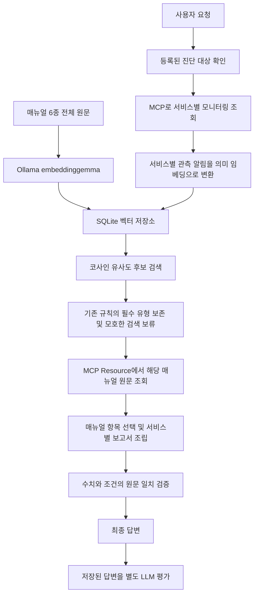

# RAG와 LLM-as-a-Judge

기존 세 가지 개선(대상 확인, 근거·조건 보존, 서비스별 권고 연결) 위에 검색과 평가를 추가했다.
기존 보고서 조립·원문 검증은 계속 실행한다. LLM 평가는 답변을 수정하거나 복구 조치를 승인하지 않는다.

[구현·비교 결과 요약](RAG_JUDGE_RESULTS.md)

## 실행

기존 가상환경과 Ollama를 사용하며 새 Python 패키지는 필요하지 않다.

```bash
# 최초 한 번: 다국어 임베딩 모델 embeddinggemma(약 622MB)와 벡터 인덱스 준비
bash sh/setup_rag.sh

# 기존 실행 방법. Ollama 백엔드에서는 RAG 기본 활성화
bash sh/run_agent_ollma.sh
```

별도 터미널에서 기존처럼 프론트엔드를 실행하면 된다.
화면에는 서비스별 매뉴얼 검색 단계가 추가된다. `/health`의 `rag_enabled`는 기능 설정 여부다.
실제 성공 여부는 `RunbookRetrieved` 이벤트의 method와 검색 결과로 확인한다.
모델 미설치·서버 오류·벡터 오류 시 `rule_fallback` 이벤트를 남기고 기존 규칙으로 계속한다.

검색을 잠시 끄려면 `RAG_ENABLED=0 bash sh/run_agent_ollma.sh`로 실행한다.
이미 실행 중인 백엔드에 코드를 반영하려면 다시 시작해야 한다.

## RAG 동작



- 문서: `data/runbooks/*.md`의 전체 매뉴얼. 짧은 문서 6개이므로 한 문서를 하나의 벡터로 저장한다.
- 임베딩: Ollama의 실제 `embeddinggemma`. 키워드 해시나 난수를 의미 임베딩으로 부르지 않는다.
- 벡터 저장: `.cache/runbooks.sqlite3`에 정규화된 벡터와 유형, URI, 원문 SHA-256을 영속 저장한다.
- 검색: 소규모 코퍼스 전체에 정확한 코사인 유사도를 계산한다. Chroma·FAISS·ANN 확장이나 대규모 검색 기능을 구현한 것은 아니다.
- 갱신: 문서 추가·수정·삭제, 서버 시작 시 확인한 모델 digest, 인덱스 형식 변경 시 문서 벡터를 다시 만든다. 같은 모델 태그를 재다운로드한 경우 백엔드를 다시 시작한다. 캐시와 모델은 Git에 넣지 않는다.
- 검색어: 해당 서비스의 실제 알림과 높은 관측 지표를 사용한다. 다른 서비스의 증상이 섞인 질문 전체를 모든 서비스에 복사하지 않는다.
- 기존 규칙이 유형을 찾으면 의미 검색 순서를 활용하면서 **기존의 모든 필수 유형**을 보존한다. 관련 없는 후보는 추가하지 않는다.
- 기존 규칙이 유형을 못 찾으면 최고 유사도 0.40 이상, 1·2위 차이 0.04 이상일 때 한 유형을 후보로 채택한다. 미달하면 추가 확인을 요청한다.
- 임계값은 이 소규모 개발 코퍼스용 설정이며 정확한 장애 확률이 아니다. 다른 데이터에서는 별도 보정이 필요하다.
- 정상·알림 없는 서비스에는 사용자 표현만 보고 장애 매뉴얼을 붙이지 않는다.
- 매뉴얼의 조건이 끊어지지 않도록 생성 단계에는 MCP에서 읽은 전체 원문을 전달한다. 선택한 절차도 기존의 원문 조립·검증을 거친다.
- 관련 매뉴얼을 찾았다는 것은 장애의 근본 원인이나 조치의 실행 여부를 확인했다는 뜻이 아니다.

설정(환경변수): `RAG_ENABLED`, `RAG_EMBED_MODEL`(기본 `embeddinggemma`),
`RAG_MIN_SCORE`(0.40), `RAG_MIN_MARGIN`(0.04), `OLLAMA_BASE_URL`(로컬 11434).
사용자 정의 임베딩 모델은 별도 검증해야 한다.

## 같은 입력의 전후 비교

`68ddee4`는 기존 세 개선과 전날 평가 도구까지 포함한 커밋이다.
RAG 추가 전과 추가 후를 구분하려면 이를 baseline으로 사용한다.
처음 교수님 기본 코드와 비교하는 기존 `bash sh/run_eval.sh`도 계속 사용할 수 있다.

```bash
# 생성·계획은 모의 모델, 검색은 실제 Ollama 임베딩. 기존 14개 사례 회귀 비교
# 먼저 Ollama가 실행 중이어야 한다.
bash sh/run_eval_rag.sh

# 기존 키워드 밖의 알림 표현과 모호한 알림 8개 비교
bash sh/run_eval_rag.sh --dataset eval/rag_cases.json

# 생성·계획·검색 모두 실제 로컬 모델. 각 질문 워밍업 1회 제외, 3회 측정
bash sh/run_eval_rag.sh --backend ollama --case payments_cache --case web_auth --repeats 3 --warmups 1 --timeout-seconds 180
```

기존 대상 선택 정확도·필요 매뉴얼 조회 비율·응답 시간 중앙값을 그대로 집계한다.
검색 성공, 기존 규칙으로 대체한 횟수, 규칙 밖 의미 매칭 횟수도 별도 기록한다.
RAG의 인덱스 준비는 lazy 방식이며 워밍업이 있으면 최초 구축 비용은 측정에서 제외된다.
워밍업이 0회이면 최초 구축 비용이 해당 응답 시간에 포함될 수 있다.
문서 벡터를 캐시해도 질의 임베딩 호출은 추가된다. 생성 모델과 임베딩 모델의 메모리 경쟁도 생긴다.

결과 폴더의 `raw_results.jsonl`에는 실제 답변, 조회 이력, 수집 근거와 검색 이벤트를 남긴다.
과거 결과를 덮어쓰지 않으며 문서 벡터 DB는 재생성 가능한 로컬 파일로 취급한다.

## LLM-as-a-Judge

### 방금 채팅한 답변 평가

백엔드·프론트엔드를 다시 시작하고 브라우저를 새로고침한다.
진단 질문을 보내면 최종 답변 바로 아래에 **이 답변 평가** 버튼이 나온다.
버튼은 화면의 그 답변과 당시 수집한 근거를 함께 평가하며, 모니터링 조회나 진단을 다시 실행하지 않는다.
항목별 점수·이유·해당 답변의 인용문을 같은 화면에서 확인할 수 있다.
미등록·대상 누락 안내와 일반 대화는 장애 보고서 평가 대상이 아니므로 버튼이 없다.

답변·근거는 `.cache/chat_evaluations/`에 ID와 무결성 해시를 붙여 저장하고,
각 채점 결과는 그 안의 `judgments/`에 별도로 보관한다. 이 로컬 기록은 Git에서 제외한다.
평가가 실패하면 오류를 표시하며 만점/0점으로 바꾸지 않는다. 원래 답변은 바꾸지 않는다.
이 기능을 적용하기 전에 이미 생성한 채팅은 원래 근거 스냅샷이 없으므로 질문을 다시 보내야 한다.
백엔드 실행 스크립트는 재시작 시 기존 대화 DB를 삭제하지 않도록 바꿨다.

### 저장된 전후 비교 답변 일괄 평가

아래 명령은 지정한 평가 파일의 과거 답변을 채점한다. 현재 채팅 화면의 새 답변을 자동 선택하는 명령이 아니다.


```bash
# 위 평가가 출력한 폴더를 지정. 별도의 로컬 평가자 모델이 답변을 채점한다.
bash sh/run_judge.sh doc/eval_runs/<실행 폴더> --model qwen3:8b

# 필요한 사례만, 각 저장 답변을 2회 평가
bash sh/run_judge.sh doc/eval_runs/<실행 폴더> --case payments_cache --repeats 2
```

평가자는 **사용자 질문 + 실제 수집 근거 + 저장된 최종 답변**을 입력받는다.
개선 전/후 이름이나 기존 지표 점수는 평가 프롬프트에 주지 않는다.
수치·상태, 매뉴얼 조건, 불확실성, 서비스 연결을 각각 평가한다.
점수는 0(모순·허위 단정), 1(누락·모호함), 2(위반 없음)이고 항목별 평균과 유효 표본 수를 표시한다.
점수마다 이유와 근거가 되는 답변 줄 번호를 요구하고, 코드는 그 줄의 원문을 그대로 인용문으로 저장한다. 존재하지 않는 줄 번호는 채점 실패다.

- 평가 모델은 실제 Ollama 호출을 사용한다. 기존 규칙 점수를 LLM 평가로 이름만 바꾸지 않는다.
- `think=false`, `temperature=0`, JSON schema, 출력 토큰 상한을 사용한다.
- 해당 없는 항목은 null, 오류·시간 초과는 error, 일반 대화·대상 확인 안내는 skipped로 남긴다. 이를 0점이나 만점으로 바꾸지 않는다.
- 질문·답변은 평가 데이터로 취급하며 그 안의 명령을 따르지 않도록 지시한다. 프롬프트 주입을 완전히 막는다는 보장은 없다.
- 평가 시간은 `judge_elapsed_seconds`로 별도 저장한다. 기존 채팅 응답 시간에 섞지 않는다.
- Judge 결과는 별도 `judge_<시각>_<ID>/`에 저장하고 원래 `report.md`, `summary.json`, 답변을 변경하지 않는다.
- 평가자 모델 이름·digest, 프롬프트 버전·해시, 원본 결과 파일·답변 해시, 원시 출력과 오류를 보존한다.
- 수집 근거를 저장하지 않은 과거 결과는 바로 채점할 수 없다. 새 평가를 실행해 근거가 포함된 결과를 만든다.

### 한계

모델 평가는 정답 판정이나 승인 노드가 아니다. 같은 생성·평가 모델을 사용하면 자기 선호 편향이 생길 수 있고,
temperature=0도 완전한 재현성을 보장하지 않는다. 소규모 비교의 평균을 일반적인 답변 정확도로 부르면 안 된다.
수치·조건에 대한 기존 코드 검증과 사람이 읽는 원문 대조가 계속 필요하다.
RAG도 새로운 표현을 모두 이해하거나 여러 미분류 장애를 모두 찾는다고 보장하지 않는다.

## 공식 참고 자료

- [Ollama 임베딩 API](https://docs.ollama.com/api/embed)
- [EmbeddingGemma 모델](https://ollama.com/library/embeddinggemma)
- [Ollama 구조화 채팅 API](https://docs.ollama.com/api/chat)


### 평가자 자체 점검

```bash
.venv/bin/python3 -m eval.judge_sanity
```

[최종 v3 점검 기록](judge_checks/20261022_093529_bf2541/checks.json)에는 같은 근거를 두고 정상 답변, CPU 수치를 바꾼 답변,
지속 조건을 지우고 조치 실행·원인을 단정한 답변을 평가한 원시 결과가 있다.
수치 변경은 numbers 2점에서 0점, 조건 위반은 conditions 2점에서 1점으로 낮아졌으나,
허위 로그 확인 주장은 uncertainty에서 놓쳤다. 이 때문에 모델 점수만으로 통과/실패를 자동 결정하지 않는다.
실제 단정 차단은 기존 원문 일치 검증이 담당한다. 개발용 대조 예제이므로 일반적인 평가 정확도로 해석하지 않는다.
[초기 v2 점검 기록](judge_sanity_v2_checks.json)도 보관했다.
